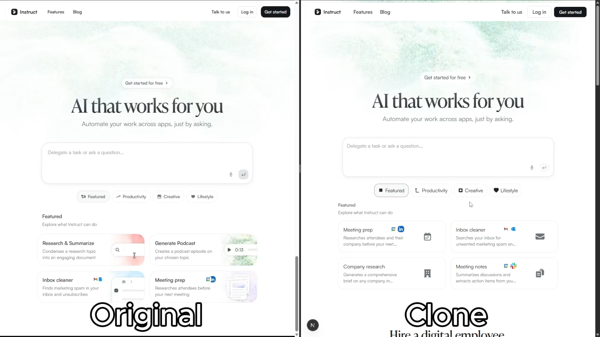
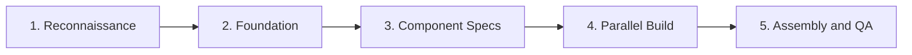
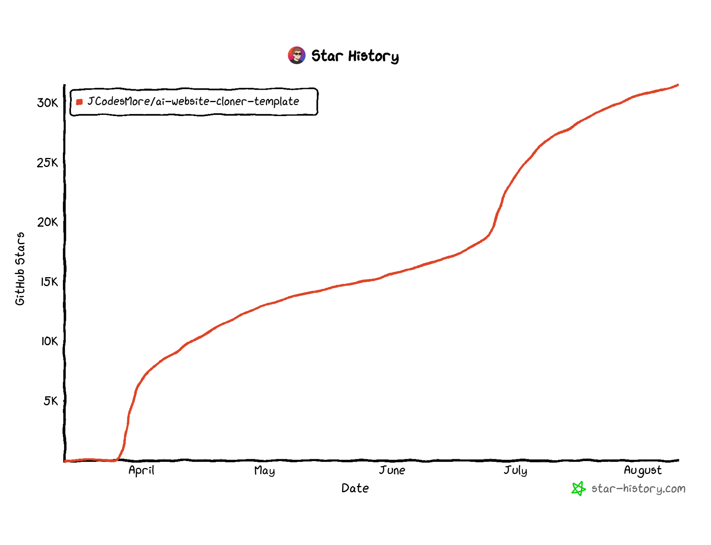

> ## 项目管理入口（先读这里）
>
> 这个仓库现在承接「AI 业务实践与学习平台」（project_id: `ai-learning-site`）。当前任务不是继续克隆网站。
>
> | 要看什么 | 去哪里 |
> |---|---|
> | 当前状态、任务表、决策、复核进度、唯一下一步（唯一状态源） | [PROJECT.md](/Users/will/Desktop/业务主线/A-部门项目/AI学习站/PROJECT.md) |
> | 背景、需求、设计（版本与复核状态以 PROJECT 为准） | [docs/AI学习项目-底层方案.md](docs/AI学习项目-底层方案.md) |
> | 已有成果与历史阶段（克隆基线 e76f680、首章教材、W01 等） | [PROJECT.md 第 3 节「现有成果索引」](/Users/will/Desktop/业务主线/A-部门项目/AI学习站/PROJECT.md#3-现有成果索引) |
>
> 旧范围、待同步：[框架图](docs/AI学习项目-框架图.html) 仍为 v2 辅助图；[v1 落地方案](docs/AI学习内容迭代-落地方案.md) 为旧范围。本 README 不维护状态。
> 下方「本机说明」和英文模板说明是**历史脚手架说明**，不代表当前任务。

---

> **本机说明（Will）**：从 JCodesMore/ai-website-cloner-template @92872bc 导入（2026-09-17），已断开上游 git、独立成本地库。
> 用法：在本目录开 Claude Code（建议 `claude --chrome`），输入 `/clone-website <网址>`。产物写入 `src/app`、`src/components/sites`、`public/sites`、`docs/research`。
> 为什么不装成全局 Skill：指令依赖本项目的 Next.js 脚手架和 `npm run build`，离开本目录会失败。卸载 = 删除本目录。
> 注意：只克隆有权使用的网站；默认会并行派子 agent + worktree，额度消耗大。
> 当前产物：vibe-hub.org 中文站复刻（基线提交 e76f680）。2026-09-17 Will 确认**不做**：英文版 /en、语言切换、交流群弹窗；语言切换按钮界面已一并删除（交流群入口从未实现，无界面可删）。后续只按需求做二次迭代。

<div align="center">

# AI Website Cloner Template

### Clone any website with one command

Give your AI coding agent a URL and watch it recreate the website as a clean Next.js app.

**Best results with [Claude Code](https://docs.anthropic.com/en/docs/claude-code) + Opus 5. Works with Codex, Cursor, Gemini, and more.**

[](https://github.com/JCodesMore/ai-website-cloner-template/generate) [](https://discord.gg/hrTSX5yTpB)

[Quick Start](#quick-start) · [Watch Demo](#demo) · [Supported Platforms](#supported-platforms)

<a href="https://github.com/JCodesMore/ai-website-cloner-template/blob/master/LICENSE"></a> <a href="https://github.com/JCodesMore/ai-website-cloner-template"></a> 

  <a href="https://trendshift.io/repositories/24302?utm_source=repository-badge&amp;utm_medium=badge&amp;utm_campaign=badge-repository-24302" target="_blank" rel="noopener noreferrer"></a> <a href="https://www.star-history.com/jcodesmore/ai-website-cloner-template/"><picture><source media="(prefers-color-scheme: dark)" srcset="https://api.star-history.com/badge?repo=JCodesMore/ai-website-cloner-template&amp;theme=dark" /><source media="(prefers-color-scheme: light)" srcset="https://api.star-history.com/badge?repo=JCodesMore/ai-website-cloner-template" /></picture></a>

<br />
<sub><strong>SPONSORED BY</strong></sub>
<br /><br />
<a href="https://www.rapidproxy.io/?ref=JCM"></a>
<br />
<sub>Power your scraping and automation with 90M+ residential IPs, 500MB free traffic, and non-expiring bandwidth. <a href="https://www.rapidproxy.io/?ref=JCM">Explore RapidProxy →</a></sub>
<br /><br />
<a href="https://www.atlascloud.ai/?utm_source=github&amp;utm_medium=sponsor&amp;utm_campaign=ai-website-cloner-template">
  <picture>
    <source media="(prefers-color-scheme: dark)" srcset="docs/assets/sponsors/atlas-cloud-logo-white.svg" />
    <source media="(prefers-color-scheme: light)" srcset="docs/assets/sponsors/atlas-cloud-logo.svg" />
    
  </picture>
</a>
<br />
<sub>Generate AI images, video, audio, and 3D assets through one API. <a href="https://www.atlascloud.ai/?utm_source=github&amp;utm_medium=sponsor&amp;utm_campaign=ai-website-cloner-template">Explore Atlas Cloud →</a></sub>

</div>

---

## Demo

[](https://youtu.be/O669pVZ_qr0)

> Click the image above to watch the full demo on YouTube.

## Quick Start

> **Important:** Start by making your own copy with GitHub's **Use this template** button. Do not clone this template repository directly for your website project, and do not open pull requests here with your generated website.

1. **Create your own repository from this template**

   On the GitHub page for this project, click **Use this template**, then click **Create a new repository**.

   Give your new repository a name, choose whether it should be public or private, then click **Create repository**. If GitHub shows an **Include all branches** option, you can leave it off.

   This gives you your own separate project to work in, so your website changes stay in your account instead of coming back to the main template.

2. **Open your new repository on your computer**

   After GitHub creates your copy, open that new repository. Click **Code** and open or clone your new repository with your preferred coding tool.

   If you use the terminal, the command will look like this:

   ```bash
   git clone https://github.com/YOUR-USERNAME/YOUR-NEW-REPOSITORY.git
   cd YOUR-NEW-REPOSITORY
   ```

3. **Install dependencies**
   ```bash
   npm install
   ```
4. **Start your AI agent** — Claude Code recommended:
   ```bash
   claude --chrome
   ```
5. **Run the skill**:
   ```
   /clone-website <target-url1> [<target-url2> ...]
   ```
6. **Customize** (optional) — after the base clone is built, modify as needed

> Most supported clients expose `/clone-website` directly. If your client activates skills from natural-language requests, enter `Clone <target-url> using the clone-website workflow`. Project instructions are in `AGENTS.md`.

## Supported Platforms

| Agent                                                         | Status                     |
| ------------------------------------------------------------- | -------------------------- |
| [Claude Code](https://docs.anthropic.com/en/docs/claude-code) | **Recommended** — Opus 5   |
| [Codex CLI](https://github.com/openai/codex)                  | Supported                  |
| [OpenCode](https://opencode.ai/)                              | Supported                  |
| [GitHub Copilot](https://github.com/features/copilot)         | Supported                  |
| [Kiro](https://kiro.dev/)                                    | Supported                  |
| [Cursor](https://cursor.com/)                                 | Supported                  |
| [Windsurf](https://codeium.com/windsurf)                      | Supported                  |
| [Gemini CLI](https://github.com/google-gemini/gemini-cli)     | Supported                  |
| [Cline](https://github.com/cline/cline)                       | Supported                  |
| [Roo Code](https://github.com/RooCodeInc/Roo-Code)            | Supported                  |
| [Continue](https://continue.dev/)                             | Supported                  |
| [Amazon Q](https://aws.amazon.com/q/developer/)               | Supported                  |
| [Augment Code](https://www.augmentcode.com/)                  | Supported                  |

## Prerequisites

- [Node.js](https://nodejs.org/) 24+
- An AI coding agent (see [Supported Platforms](#supported-platforms))

## Tech Stack

- **Next.js 16** — App Router, React 19, TypeScript strict
- **shadcn/ui** — Radix primitives + Tailwind CSS v4
- **Tailwind CSS v4** — oklch design tokens
- **Lucide React** — default icons (replaced by extracted SVGs during cloning)

## How It Works

The `/clone-website` skill runs a multi-phase pipeline:



1. **Reconnaissance** — screenshots, design token extraction, interaction sweep (scroll, click, hover, responsive)
2. **Foundation** — updates fonts, colors, globals, downloads all assets
3. **Component Specs** — writes detailed spec files (`docs/research/components/`) with exact computed CSS values, states, behaviors, and content
4. **Parallel Build** — dispatches builder agents in git worktrees, one per section/component
5. **Assembly & QA** — merges worktrees, wires up the page, runs visual diff against the original

Each builder agent receives the full component specification inline — exact `getComputedStyle()` values, interaction models, multi-state content, responsive breakpoints, and asset paths. No guessing.

## Use Cases

- **Platform migration** — rebuild a site you own from WordPress/Webflow/Squarespace into a modern Next.js codebase
- **Lost source code** — your site is live but the repo is gone, the developer left, or the stack is legacy. Get the code back in a modern format
- **Learning** — deconstruct how production sites achieve specific layouts, animations, and responsive behavior by working with real code

## Not Intended For

- **Phishing or impersonation** — this project must not be used for deceptive purposes, impersonation, or any activity that breaks the law.
- **Passing off someone's design as your own** — logos, brand assets, and original copy belong to their owners.
- **Violating terms of service** — some sites explicitly prohibit scraping or reproduction. Check first.

## Project Structure

```
src/
  app/              # Next.js routes
  components/       # React components
    ui/             # shadcn/ui primitives
    icons.tsx       # Extracted SVG icons
  lib/utils.ts      # cn() utility
  types/            # TypeScript interfaces
  hooks/            # Custom React hooks
public/
  images/           # Downloaded images from target
  videos/           # Downloaded videos from target
  seo/              # Favicons, OG images
docs/
  research/         # Extraction output & component specs
  design-references/ # Screenshots
scripts/
  sync-agent-rules.sh  # Regenerate agent instruction files
  sync-skills.mjs      # Regenerate /clone-website for all platforms
.kiro/skills/          # Generated Kiro workspace skill
.cline/skills/         # Generated Cline workspace skill
.roo/skills/           # Generated Roo Code workspace skill
.roo/commands/         # Generated Roo Code slash command
AGENTS.md           # Agent instructions (single source of truth)
CLAUDE.md           # Claude Code config (imports AGENTS.md)
GEMINI.md           # Gemini CLI config (imports AGENTS.md)
```

## Commands

```bash
npm run dev    # Start dev server
npm run build  # Production build
npm run lint   # ESLint check
npm run typecheck # TypeScript check
npm run check  # Run lint + typecheck + build
```

### If using docker

```bash
docker compose up app --build # build and run the app
docker compose up dev --build # run the app in dev mode on port 3001
```

## Updating for Other Platforms

Two source-of-truth files power all platform support. Edit the source, then run the sync script:

| What                   | Source of truth                         | Sync command                       |
| ---------------------- | --------------------------------------- | ---------------------------------- |
| Project instructions   | `AGENTS.md`                             | `bash scripts/sync-agent-rules.sh` |
| `/clone-website` skill | `.claude/skills/clone-website/SKILL.md` | `node scripts/sync-skills.mjs`     |

Each script regenerates the platform-specific copies automatically. Agents that read the source files natively need no regeneration.


## Star History



## License

MIT

<sub>Translations: <a href="README.ja.md">日本語</a> · <a href="README.zh-CN.md">Simplified Chinese</a></sub>

---

## AI 应用课程（/courses，原 /learning）

- **是什么（2026-09-19 起）**：AI 课程并入页头“课程”（`/courses`）。首页分两组：“AI 应用课程”（6 个模块 = 6 门课，共 24 章）和原有的“Web Coding 课程”（产品官网、Git 不变）。只有第 1 门“AI 使用基本功”的 4 章（l01–l04）有正文，其余章节显示“待编写”和目录计划，不编造正文、题目或进度。
- **地址规则**：课程概览 `/courses/ai-m1`…`ai-m6`；章节 `/courses/ai-mN/lNN`（课号不属于该课返回 404）。旧地址 `/learning` 跳到 `/courses`，`/learning/lNN` 跳到新章节地址（保留 `#小节` 锚点），未知课号 404。课号、版本和本机存储键（`ai-learning-next:v1:progress` 等）都没变，旧进度照常显示。页头原“学习路线”入口已去掉。
- **页面组成**：概览页写学什么、学完能做什么、先修、章节卡；“开始学习”按钮直达第一章，不显示进度或成绩。章节页有返回目录、本章目录、上一章/下一章。AI 课程分组下的二级入口是“AI 术语图鉴”“AI 练习”。路由工具在 `src/lib/ai-learning/course-routes.ts`，页面组件在 `src/components/ai-learning/ai-course-*.tsx`，课程配图 `public/assets/ai-course-blueprints.svg`（原创示意图）。
- **正文归谁管**：教材母源在 `/Users/will/Desktop/业务主线/A-部门项目/AI学习站/sources`（course.yaml、glossary.yaml、lessons/）。本仓库**不存第二份教材**，`src/lib/ai-learning/generated.json` 和 `rendered.json` 都是生成文件，不要手改；改正文请改母源。
- **章节版式（2026-09-19 起）**：AI 章节页照搬 Web Coding 课程章节页的排版——标题 + 一句导语 + 可折叠「本章信息」，小节标题不编号，右侧本章目录随滚动高亮，最后是浅灰“本章总结”框。示意图只有五种写法（flow / compare / before-after / chat / checklist），作者在 lesson.md 里用 `::: figure 类型 标题 | 副标题` 纯文字书写，由 `scripts/render-ai-learning.mjs` 转成统一样式；写错格式时 `npm run content:ai` 会报出第几行。完整写法见母源 `sources/course-materials.md` 的「章节版式模板」。样板章是 l01；l02–l04 正文未改写，只是跟着换了排版。
- **本机依赖（不在本仓库安装）**：读取和校验母源用 `/Users/will/code/AI学习平台/教材引擎/scripts/content-lib.mjs`；Markdown 编译用该仓库已安装的 VitePress（`/Users/will/code/AI学习平台/教材引擎/node_modules/vitepress` 的 `createMarkdownRenderer`）。换机器时可用绝对路径环境变量覆盖：`AI_LEARNING_SOURCE_DIR`、`AI_LEARNING_CONTENT_LIB`、`AI_LEARNING_VITEPRESS_DIR`。
- **课程 / 术语 / 练习分开（2026-09-19 起，第 1 章已拆分）**：照克隆站结构，课程页只放正文、示意图和演示；正文里的关键词（母源写 `[文字](term:id)`）渲染成 `.course-term-ref` 按钮，点开在侧栏显示术语图鉴卡片（`src/components/ai-learning/ai-term-workspace.tsx`）。术语进术语图鉴 AI 组（`/topics/ai`，新增大语言模型、上下文、训练、推理、记忆 5 张卡），题目进练习页（`/practice?scope=ai`：6 道判断题 + 2 张「写一写」卡，写完看解析对照要点，不计分、不保存）。转换逻辑在 `scripts/ai-site-catalog.mjs`，生成 `src/lib/ai-learning/site-catalog.json`，由 `src/lib/vibehub/data.ts` 合并进图鉴和练习数据；写错字段时 `npm run content:ai` 报错。题目编号（`ai-l01-q1` 等）固定，留给以后的登录与学习记录。网站定位是自愿学习通道：进度记录已下线，`/learning/me` 跳到练习页（浏览器里的旧记录没删）；课程列表和概览不再显示进度。l02–l04 还没拆分，章内暂留旧测验块。写法见母源 `sources/course-materials.md`「课程 / 术语 / 练习分开」。
- **命令**：`npm run content:ai` 先跑 `scripts/generate-ai-learning.mjs`（生成 generated.json），再跑 `scripts/render-ai-learning.mjs`（生成 rendered.json）。`npm run dev`、`npm run build`、`npm run check` 之前会自动先跑一次，避免悄悄用旧数据。测试：`node --test scripts/*.test.mjs`。
- **为什么这样做**：Markdown 在 Next 之外预先编译，浏览器不加载 VitePress/Vue；正文只放行这几章实际用到的结构标签，遇到脚本、事件属性、未知组件直接失败并保留上一次的输出（这不是通用 HTML 净化器）。
- **状态**：内容为 **draft（内容复核通过，待本人试学）**，团队开放状态 **not_open**；四章标“可试读·待本人验收”，不代表已验收或已发布。
- **本机学习功能（2026-09-19 接入；第 1 章拆分后只剩 l02–l04 使用，进度汇总已下线）**：四章正文之后有“本章测验与进度”（`#assessment`）：标记已读、6 道单选 + 1 道简答、漏答时列出缺项不提交、提交后逐题显示选择/正确答案/解析和回看小节、简答按要点自查并手动确认（不是 AI 评分）、空白表单重做、首次与最近一次成绩；课程地图显示可试读课的本机进度，待编写课不显示。记录只存在当前浏览器的 localStorage：不上传，换浏览器或清除浏览器数据会丢失；这是自测，不是正式考试。评分规则来自 `src/lib/ai-learning/assessment.mjs`，未提交的作答不保存。
- **我的学习（`/learning/me`，已下线，现跳转到 `/practice`）**：原把上面四章的本机记录汇总到一页：每课状态、已读、首次与最近一次成绩（旧版本作答单列、不计入）、作答/重测/借助笔记或 AI 的次数、简答自查是否完成，以及“下一步”链接（没通过时直达第一个要回看的小节，否则直达该课 `#assessment`）。完成数只按 4 门可试读课算，20 门待编写课单独标注、不算未完成；不显示简答原文，不统计学习时长、连续天数或能力百分比，没有排名；不上传、不重置、不导出。组件 `src/components/ai-learning/my-learning.tsx` 暂留未用。
- **模拟案例与作业（`/learning/cases`、`/learning/practice`，2026-09-19 接入，S3-A；入口在练习页底部）**：`/learning/cases` 是案例模板（业务问题、SC/差距、步骤、可复用资产、证据、边界、相关章节）加一份原创的模拟周报练习：列出全部输入材料、有来源的事实与缺失信息、为什么要人工核对，SC/差距标“待业务项目确定”，相关章节链到第 02–04 课页面。页首明确写着“尚无已验收业务案例；以下为模拟练习，不是客户案例/业务成果”。`/learning/practice` 是空白练习草稿：点“保存草稿”才写入当前浏览器（只用一个键 `ai-learning-next:v1:practice-draft`，不碰学习进度），刷新后恢复；显示未保存提示；读不懂的旧记录先备份再覆盖；另一个标签页先保存过时拒绝保存并提示手动留底，不自动合并；“复制为 Markdown”只在点击时写剪贴板，失败时给可选中的文本框手动复制，复制内容标“模拟练习草稿 / 未验收 / 未提交”，空项写“待补充”。没有提交、审核、删除、导出或评分。存储规则在 `src/lib/ai-learning/practice-draft.mjs`，测试：`node --test scripts/practice-draft.test.mjs`。真实案例收集、提交渠道和审核流程（S3-B）**待 Will 决定**，未实现。状态：draft，团队开放 **not_open**；本功能的测试、`npm run check` 和浏览器验证**待运行**，独立审查**未完成**。
- **验证现状**：技术检查已通过（Codex 于 2026-09-19 跑过 46 项测试和 `npm run check`，并在测试端口浏览器里验证了漏答阻止、全对提交、简答自查、刷新后恢复）；独立审查**未完成**；Will **未试学**；团队开放状态仍是 **not_open**。以上都不代表整站已验收或已发布。

### Skill 实践样板（2026-09-20）

入口 `/practice`，任务页 `/practice/meeting-skill`。原创模拟内容母源：`/Users/will/Desktop/业务主线/A-部门项目/AI学习站/sources/practice/meeting-skill/`。
运行 `python3 scripts/generate-practice-pilot.py`（可传 `--source <目录>`）只生成该任务的 JSON 与三个下载包；不触及课程母源或课程生成文件。不要手改 `src/lib/ai-learning/practice-pilot.json` 和 `public/practice/meeting-skill/`。
此版本不记录实践进度、上传材料或调用模型。Skill 实际运行与同事复现由试做记录验收，网页可用不代表对客交付已验证。

### GPT Sites 私有试学部署（2026-09-20）

- 已发布版本 1：[AI 学习站](https://ai-learning-practice.willxiong92.chatgpt.site)，仅站点所有者可访问，需使用对应 ChatGPT 账号登录。团队开放仍为 `not_open`，本人试学待验收。
- 原站保留 Next standalone；Sites 静态构建快照在 `/Users/will/code/AI学习平台/发布快照`，发布仓库在 `/Users/will/Documents/Codex/2026-09-19/ke-yi/work/sites-release`。后者的 `.openai/hosting.json` 指向 `out`，是实际发布配置。
- 静态适配将目录搜索放到浏览器端，并为使用查询参数的页面添加 Suspense；沿用现有已生成内容，不运行 `content:ai`，不推广 L03 待审母源。后续修改须同步新快照、验证导出、提交并推送准确版本，再保存和部署至同一 project_id；不要直接重发旧 out。
- 发布回执：`/Users/will/Documents/Codex/2026-09-19/ke-yi/work/sites-deploy/deployment.json`。本地静态搜索、练习跳转与产物检查通过，线上已确认登录门禁；登录后的线上内容尚未验证。
- 技术词典新增 32 个术语（2026-09-23 同步参考站 2026-09-20 的更新）：只同步术语卡片、详情页、词典分类和更新日志，参考站的练习、小测验、课程和广告不跟进，参考站删掉的内容本站也不删。`agent-memory` 改名为“Agent 记忆”，避免和 AI 课程里的“记忆”重名。已放进快照，并在发布仓库提交 `7ed1526`；**尚未部署**，由 Codex 发布到同一 project_id。


## 课程与实践路线更新（2026-09-20）

课程按基础与按需进阶组织，实践含 L01–L04 四个教学模拟试做与其余23个任务框架；Skill栏目只承载已核验团队资产，当前显示待上架。新实践母源为 `/Users/will/Desktop/业务主线/A-部门项目/AI学习站/sources/practice/curriculum.json`，单独运行 `python3 scripts/generate-practice-curriculum.py` 生成展示JSON，不运行旧课程生成器，保持L03冻结。

Sites导出目录为 `/Users/will/code/AI学习平台/发布快照`，使用 `node node_modules/next/dist/bin/next build --webpack` 避开Turbopack中文路径异常；本轮检查138项通过，桌面/390px页面人工核验。旧教材和历史练习记录保留，不新增账号、计分或真实数据上传。材料尚未构成Accio Work实跑或业务效果验证。


### 实践改为业务案例（2026-09-20）
实践首页按场景/成果/关键能力展示，不按课号布置作业。L01–L04共用询盘回复案例，旧单点练习保留补充入口。案例母源为项目 `sources/practice/cases.json`，运行 `python3 scripts/generate-practice-cases.py` 生成展示数据与模拟TXT，勿运行冻结课程生成器。后续4个案例仅规划。

## AI 协作手册（/ai-collab，2026-10-01 小样）

- **是什么**：讲人和 AI 怎么配合的栏目。导航里替换了「防止 AI 味儿」；旧栏目的页面、组件和数据已于 2026-10-01 经 Will 确认删除，需要时从 git 历史找回。
- **一张卡 = 一个坑的一整套**（Will 2026-10-01 定）：一个真实案例 + 它背后的主原理 + 案例自带的沟通范式，合成一张卡、一个详情页，和课程、术语一样「一个内容一张卡」。卡片标题是范式名（如「先看样，再开工」），灰框里是一句能直接发给 AI 的话。详情页按「先讲事，再讲理」排：一句话 → 事情经过 → 为什么会这样（对照表、原理、关键点）→ 下次怎么说（可复制模板）→ 换个场景练一练。没有自己主案例的原理（目前 P-02）在「为什么会这样」末尾提一句。目前只开「先看样，再开工」（`/ai-collab/c-002`），「改旧东西，先划线」在入口页只露卡片，详情页 404。
- **正文从哪来**：母源是本机 `~/Desktop/AI学习/E-工具与环境/Codex协作复盘/学习案例/`，网站里只放每个文件「上半｜正文」的脱敏副本 `src/lib/collab-handbook/handbook.json`，不手改；下半的内部档案一行都不读。
- **更新命令**：母源改了以后跑 `npm run content:collab`；只想看副本是不是旧了，跑 `npm run content:collab -- --check`。这一步**不**挂在 dev / build 前面：发布环境读不到本机母源。
- **脱敏怎么保证**：`scripts/sync-collab-handbook.mjs` 把母源里互相引用的文件名换成站内名称，按清单做精确替换，再扫一遍禁用词（人名、工具和平台名、公司名、本机路径、链接、内部卡号）；任何一处命中就报错、不写文件。精确替换在母源里找不到原文时也报错，提醒重新过一遍脱敏。母源新增条目要先在脚本的 `ENTRIES` 里登记、在 `TOPICS` 里配成卡，开详情页要加进 `PUBLISHED`。母源每个小节放进详情页哪一块由脚本里的对照规则决定，母源新增了没登记的小节标题会报错，不会悄悄丢内容。
- **原理状态**：母源里都是「假设」，网站统一标「试行」，写明各有几条案例支撑（按案例里「这是哪条原理的实例」自动数）。

- **详情页排版**（Will 2026-10-01：参考课程页，结构化、评述短、多用左右结构）：同步脚本不输出整段文章，而是把母源里本来就有的结构认成一块块部件——事情经过排成「同一句话 → 两边结果」左右对照，完整经过折叠；对照表变成「当时以为 → 实际缺的」左右行；误区、「为什么 AI」变成三栏卡；关键点变成左要点右解释的编号清单；步骤表变成横向步骤条；范式简版和完整版左右并排、各带复制按钮；练一练左题目、右折叠答案。正文宽度不到 640px 时自动收成一栏。文字一字不改，网站自己只加很短的栏目标签。「事情经过」摘哪几句由脚本里的 `STORY_LAYOUT` 指定，每句都要能在母源原文里找到，找不到就报错；母源表头改名、多出一张没登记的表也报错。

  *为什么这样拆*：最早的小样把原理、案例、范式各做成一页，读者要来回跳三页才拼出一件事；按「一个坑」合成一张卡后，一页读完就能直接拿走那句话去用。原理以后有了第二个案例，就会同时出现在两张卡里，各自讲各自的经过。
